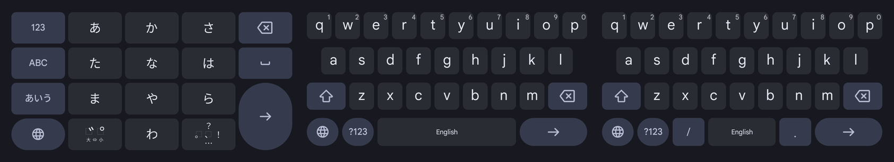

# Gboard iOS-style JP/EN Patches (for Morphe)

Gboard の日本語フリックと英語キーボードを iPhone 風の配置にする、非公式の [Morphe](https://morphe.software) 用パッチです。

## 使い方

1. Morphe Manager にこのリポジトリをソースとして追加します。

   

   または `https://github.com/twelvehouse/gboard-ios-style-jp-en-morphe-patches` を手で追加します。
2. 対応する版の Gboard（下のパッチ一覧を参照）にパッチを当てて、インストールします。
3. Android の設定で、パッチを当てた Gboard を有効にして選びます。

## おすすめの設定

Gboard の設定で次のようにすると、スクリーンショットと同じになります。

- **言語 → 日本語 → 12 キー → フリックのみ**: オン（同じ文字を続けて入力できます）
- **Preferences → Number row**: オン（英字キーボードの上に数字の段）
- **Preferences → Comma key / Period key**: オフ

## 注意

- パッケージ名を変えるので、元の Gboard とは別のアプリとして入ります。
- 新しい版を上書きインストールしても配置が変わらないときは、パッチを当てた Gboard のデータを消してください（Gboard がキーボードの定義をデータに保存しているためです）。
- 上書きインストールするには、前回と同じ鍵で署名する必要があります。

## パッチ一覧

<!-- PATCHES_START EXPANDED -->
> **[v1.0.0](https://github.com/twelvehouse/gboard-ios-style-jp-en-morphe-patches/releases/tag/v1.0.0)**&nbsp;&nbsp;•&nbsp;&nbsp;`main`&nbsp;&nbsp;•&nbsp;&nbsp;3 patches total

📦 Gboard&nbsp;&nbsp;•&nbsp;&nbsp;3 patches

 

**Package name:** `com.google.android.inputmethod.latin`

**🎯 Supported versions:**

| 18.5.4.993608717-release-arm64-v8a | 18.5.4.993608717-release-x86_64 |
| :---: | :---: |

| 💊&nbsp;Patch | 📜&nbsp;Description | ⚙️&nbsp;Options |
|----------|----------------|-----------|
| [Change package name](#change-package-name) | Installs the patched Gboard as a separate app next to the stock Gboard, which is usually a system app that cannot be replaced by an APK with another signature. | • Package name |
| [iOS QWERTY layout](#ios-qwerty-layout) | Puts the globe key of the letter keyboards at the bottom left, where it is on the Japanese 12-key keyboards, and lays out the English symbol keyboard like the iOS "123" and "#+=" pages. Gboard's number row setting keeps working. |  |
| [iOS flick layout](#ios-flick-layout) | Changes the Japanese 12-key keyboard to the layout of iOS with "flick only" enabled: 123, ABC and あいう keys and the globe key on the left, and backspace, space and a two-row enter key on the right. |  |

<!-- PATCHES_END -->
